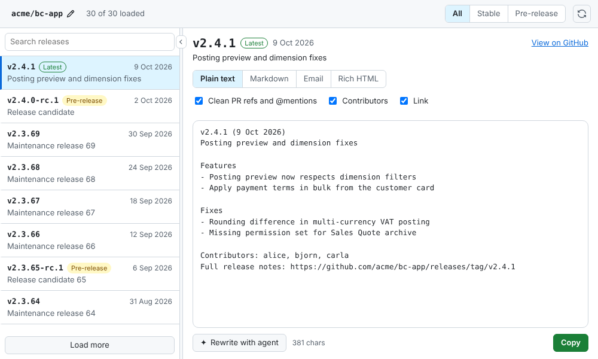
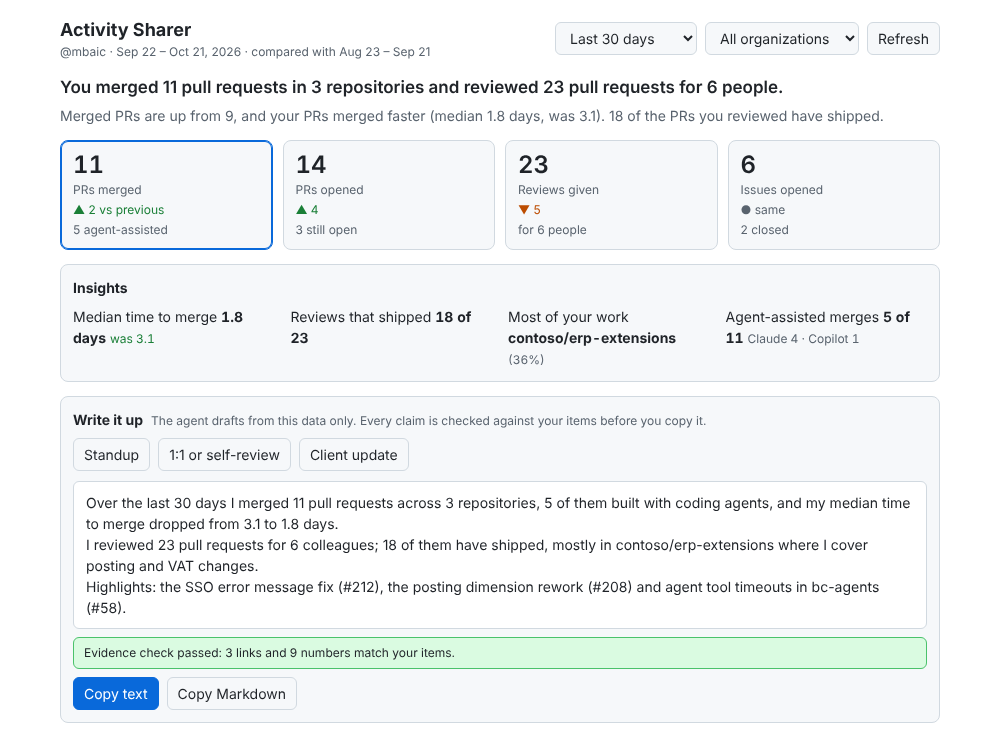

# Copilot canvases: Release Sharer and Activity Sharer

Two independent plugins for the GitHub Copilot app, from one marketplace (`release-sharer`). Install either or both.

| Plugin | What it does | Status | Install |
|---|---|---|---|
| [Release Sharer](plugins/release-sharer/README.md) | Pick a release of the current repo and copy it as text, Markdown or email | 0.2.2, not tagged yet | `copilot plugin install release-sharer@release-sharer` |
| [Activity Sharer](plugins/activity-sharer/README.md) | What you shipped, reviewed and left open on GitHub for a period, plus an evidence-checked write-up | 0.2.2, built; not verified in the app yet | `copilot plugin install activity-sharer@release-sharer` |

First add the marketplace once: `copilot plugin marketplace add mbaic/mb-copilot-release-sharer`. Full steps: [docs/INSTALL.md](docs/INSTALL.md). Updating: [docs/UPDATE.md](docs/UPDATE.md).

## Release Sharer

A canvas for the GitHub Copilot app: pick a release of the current repo and copy it as plain text, Markdown or email.



- Auto-detects the repo (or type `owner/repo`), lists releases with filter and search.
- Links the merged pull requests behind each release (from the notes and the commits since the previous release), in the canvas and optionally in the copied text.
- Start skill `mb-release-sharer` opens the canvas from a prompt.
- Cleans PR refs and @mentions, adds contributors and a release link, editable preview with undo.
- "Rewrite with agent" for Customers or Internal; the agent can also list, render and select releases.
- Resizable split view, narrow layout, light/dark, keyboard accessible.

### Install

```
copilot plugin marketplace add mbaic/mb-copilot-release-sharer
copilot plugin install release-sharer@release-sharer
```

Full steps and troubleshooting: [docs/INSTALL.md](docs/INSTALL.md). To update an installed copy, see [docs/UPDATE.md](docs/UPDATE.md).

### Use

1. Open a session in a folder cloned from a GitHub repo (`gh` must be logged in).
2. Start it with the skill: type `/mb-release-sharer`, or ask "use the mb-release-sharer skill" or "open the Release Sharer canvas". Name a repo (`owner/repo`) or release tag in the prompt to open it there.
3. Pick a release, choose a format, toggle Clean / Contributors / Link / Pull requests, edit, then Copy (links stay clickable when pasted into Outlook, Teams or Gmail; on the Email tab use Copy subject for the subject line). Merged PRs are listed under the toggles and open in the browser.
4. Ask the agent for more: "list releases", "render v1.2.3 as email", "which PRs are in v1.2.3?", "select v1.2.2", or use "Rewrite with agent".

Skill and canvas discovery in the real app are still unverified ([findings U10](docs/FINDINGS.md)). Requires `gh` logged in. Extensions run with your user privileges; review the source before installing.

## Activity Sharer



*Design mock with sample data, not a screenshot of the working canvas ([dark variant](docs/img/activity-sharer-dark.png)). Real screenshots replace it once the canvas has run in the app.*

What you shipped, reviewed and left open on GitHub across every repo and org, for a chosen period, with an evidence-checked write-up for a standup, 1:1 or client update.

- Tiles for PRs merged, open PRs now, reviews given and issues opened; merged, reviews and issues show their change against the previous window of equal length. Select a tile to list its items. Insights (median time to merge, reviewed PRs that shipped, top repository), open loops (your open PRs with age, review requests waiting on you), a chart and a repository table. Organization filter (tick the organizations to include).
- "Write it up": Standup, 1:1 or self-review, Client update. The agent drafts from the canvas data; the canvas checks every link, reference, date and number against your items and flags mismatches before you copy as text or Markdown.
- Agent actions: ask in chat ("draft my Q3 self-review") and the agent uses `get_activity` for verified data. Start skill: `/mb-activity-sharer`.
- Limits are shown in the canvas: private contributions GitHub counts but does not list, the 100-item caps, SSO organizations that are not authorised.
- Agent-assisted PR tagging is built but off until spike check S7 is confirmed on real PRs.

### Install

```
copilot plugin install activity-sharer@release-sharer
```

(after adding the marketplace once, see above). Requires `gh` logged in. Reads your activity through `gh` only; stores nothing. See [docs/INSTALL.md](docs/INSTALL.md), section 6.

## Status

Release Sharer 0.2.2 and Activity Sharer 0.2.2, neither tagged yet. Platform behavior is still being verified in the real app ([findings](docs/FINDINGS.md), [tests](docs/TESTING.md)).

## Development

Node 22+, no dependencies: `npm run ci`, `npm run dev` (Release Sharer UI), `npm run dev:activity` (Activity Sharer UI, made-up data), `npm run smoke`, `npm run spike:activity`. See [CONTRIBUTING.md](CONTRIBUTING.md) and [SECURITY.md](SECURITY.md).
